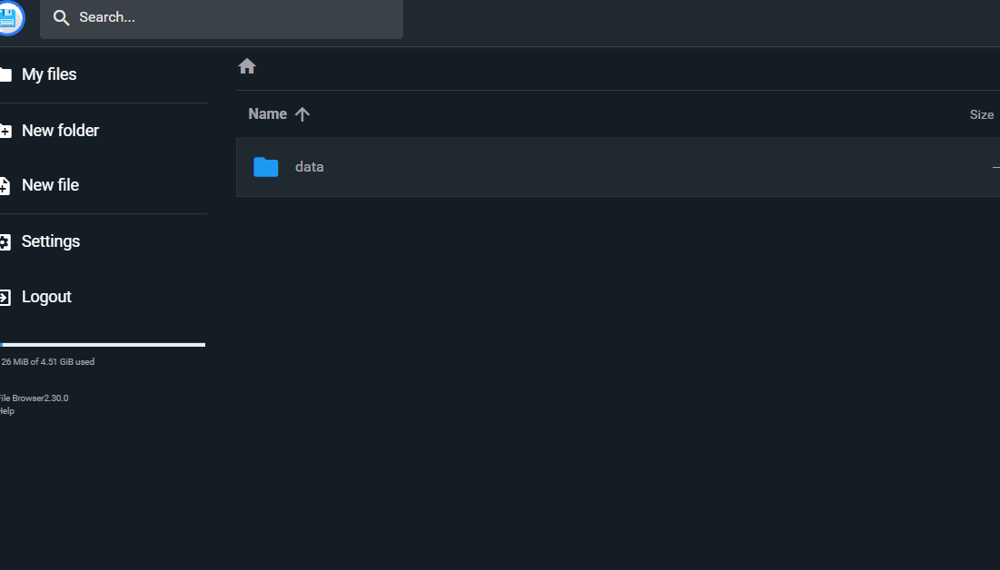

# Glass Explore

(c)2026 Jon Robinson. All Rights Reserved.

Glass Explore is a Dash web app for exploring architectural glazing products from the International Glazing Database (IGDB). It lets you pick glass products, build a simple insulated glass unit, and calculate optical and thermal properties using `pywincalc`.

The app currently focuses on the `Energy` page:

- search and filter IGDB glass products
- plot solar transmittance, visible transmittance, and colour spaces
- build a double-glazing unit with a coated lite, gas gap, and clear/ultraclear lite
- calculate U-value, SHGC or solar factor, visible transmittance, reflectance, and transmitted/reflected colours

## Requirements

- Python 3.11
- Poetry
- The data files under `data/`, including `data/igdb.sqlite`, which is not in the repository (see [Data Files](#data-files))
- Microsoft Access Database Engine or Microsoft Access, only when converting a new IGDB `.mdb` file

Python 3.11 is currently used because `pywincalc` has had install/runtime issues with Python 3.12.

## Local Development

From the project root:

```powershell
poetry install
poetry run python glass_explore/app.py
```

The development server starts the Dash app. The root URL redirects to `/energy`.

For production-style local testing:

```powershell
poetry run python production.py
```

or with Gunicorn in a Linux-like environment:

```bash
poetry run gunicorn production:server
```

## Project Layout

- `glass_explore/app.py` - Dash app entry point
- `glass_explore/pages/energy.py` - Dash page registration and top-level page layout
- `glass_explore/energy_layout.py` - UI components for the Energy page
- `glass_explore/callbacks_energy.py` - Dash callbacks and user interaction logic
- `glass_explore/igdb.py` - IGDB SQLite/parquet lookup helpers
- `glass_explore/mywincalc.py` - `pywincalc` integration and calculation setup
- `glass_explore/optics.py` - converts IGDB spectral data into Optics-style temporary files
- `glass_explore/glass_model/` - glass build-up model and shareable `gstr` protocol
- `scripts/update_igdb.py` - IGDB conversion/parquet preparation script
- `data/standards/` - optical standard files used by `pywincalc`

## Data Files

The app expects these local files:

- `data/igdb.sqlite`
- `data/glass.parquet`
- `data/readable_glass.parquet`
- `data/standards/*`

`glass.parquet` is the main preprocessed glass table used for fast app loading. `igdb.sqlite` is used for detailed lookups such as spectral data, gas properties, and glazing properties.

### The IGDB database is not in git

`data/igdb.sqlite` is about 250 MB, which is over GitHub's 100 MB file limit, and this project does not use Git LFS. The file is listed in `.gitignore` and exists only:

- on the development machine, at `data/igdb.sqlite`
- in production, on the Railway volume (see [Railway Deployment](#railway-deployment))

Git holds no copy, so keep a backup of the file somewhere outside the repository.

The two parquet files and `data/standards/` are small and are committed as normal.

### Setting up a new clone

A fresh clone has no `data/igdb.sqlite`, and the app will not start without it (`FileNotFoundError: IGDB SQLite file not found`). Use one of these:

1. **Copy the file** from another machine or a backup into `data/igdb.sqlite`. This is the quickest route.
2. **Rebuild it** from LBNL WINDOW, following [Updating IGDB Data](#updating-igdb-data). The update script imports `glass_explore`, which refuses to load when `data/igdb.sqlite` is missing, so create an empty placeholder first:

   ```powershell
   New-Item data/igdb.sqlite -ItemType File
   ```

To check the file is good, start the app and open the About modal: it shows the IGDB version read from the data. If lookups fail with `sqlite3.DatabaseError: file is not a database`, the file is damaged or is not the real database (it should be roughly 250 MB).

## Updating IGDB Data

The IGDB is updated periodically by LBNL:

https://windows.lbl.gov/igdb-downloads

The downloaded `Glazing.mdb` file is password protected, so this project does not read that file directly. Instead, update the glass library inside LBNL WINDOW:

1. Open LBNL WINDOW.
2. Go to **Libraries > Glass**.
3. Use **Update IGDB**.
4. WINDOW writes an unprotected Access database, usually at:

```text
C:\Users\Public\LBNL\WINDOW7.8\w7.mdb
```

or, for older installations:

```text
C:\Users\Public\LBNL\WINDOW7.7\w7.mdb
```

To convert/update the local app data, use:

```powershell
poetry run python scripts/update_igdb.py
```

As currently set, the script does both steps: it converts the Access database at `C:\Users\Public\LBNL\WINDOW7.8\w7.mdb` into `data/igdb.sqlite`, replacing the tables already there, and then rebuilds `data/glass.parquet` from it. To rebuild only the parquet file from the existing SQLite database, edit `scripts/update_igdb.py` and set:

```python
convert_access_file = False
```

After an update:

1. Run the app locally. The About modal should show the new IGDB version.
2. Commit the updated `data/glass.parquet`. `data/igdb.sqlite` is ignored by git and stays local.
3. Back up the new `data/igdb.sqlite`.
4. Upload the data files to the Railway volume (see [Web volume data on Railway](#web-volume-data-on-railway)). Production does not pick up new data from a deploy.

## Railway Deployment

Railway is the current deployment target.

Deployment assumptions:

- Python 3.11
- Poetry dependencies from `pyproject.toml` and `poetry.lock`
- parquet files for fast app startup
- all three data files (`igdb.sqlite`, `glass.parquet`, `readable_glass.parquet`) stored on a Railway volume

`data/igdb.sqlite` is not in the repository, so a deploy never contains it. Production reads its data from the Railway volume, and the volume must hold all three files.

The data source is controlled by `GLASS_EXPLORE_DATA_SOURCE`:

| Value | Behaviour |
| --- | --- |
| `auto` (default when unset) | Uses the volume when all three files are there. Otherwise falls back to the deployed `data/` directory, which has no database, so the app fails at startup. |
| `volume` | Always uses the volume. |
| `bundled` | Always uses the deployed `data/` directory. This no longer works, because the database is not deployed. |

The app expects the mounted volume at:

```text
/igdb
```

The current production paths are built from:

```text
/igdb/storage/data/igdb.sqlite
/igdb/storage/data/glass.parquet
/igdb/storage/data/readable_glass.parquet
```

All three files are read from the volume, including the parquet files. A change to `data/glass.parquet` in the repository does not reach production until it is uploaded to the volume too.

### Web volume data on Railway

To update the data files on the Railway web-volume:

1. Disconnect the web-volume from the main web service and connect it to the FileBrowser service.
2. Go to the FileBrowser remote URL and upload the whole local `data` directory as a sub-directory of the remote root directory.
3. Reconnect the web-volume to the main web service and make sure the service restarts. The app loads the data once at startup, so it keeps serving the old data until it restarts.

The diskcache keys include the `glass.parquet` file timestamp and size, so the new files bypass stale cached graph/search data.



## License

This project is licensed under AGPL-3.0. See `LICENSE`.
